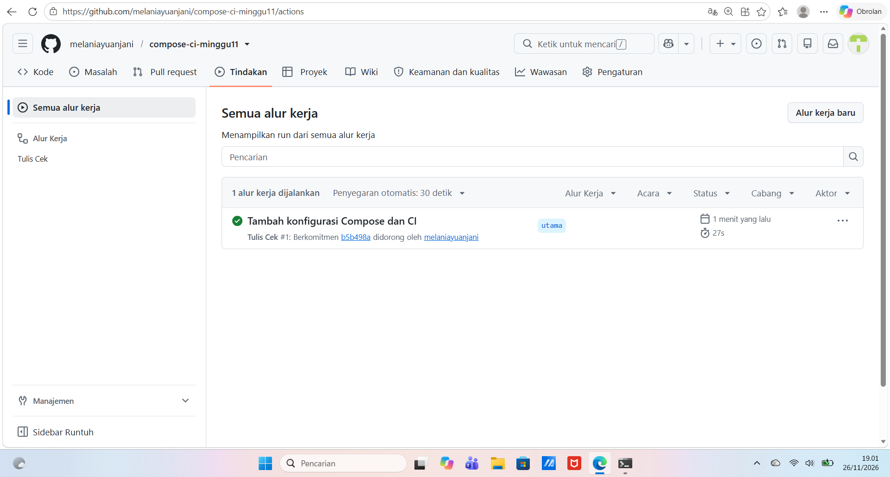
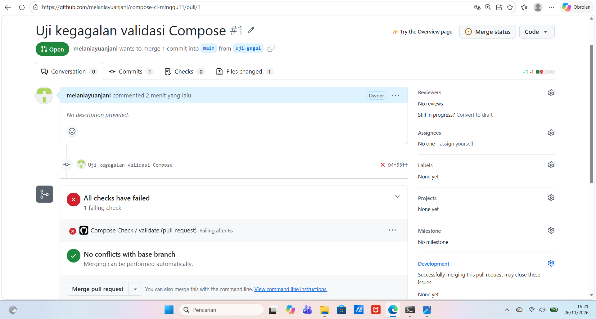
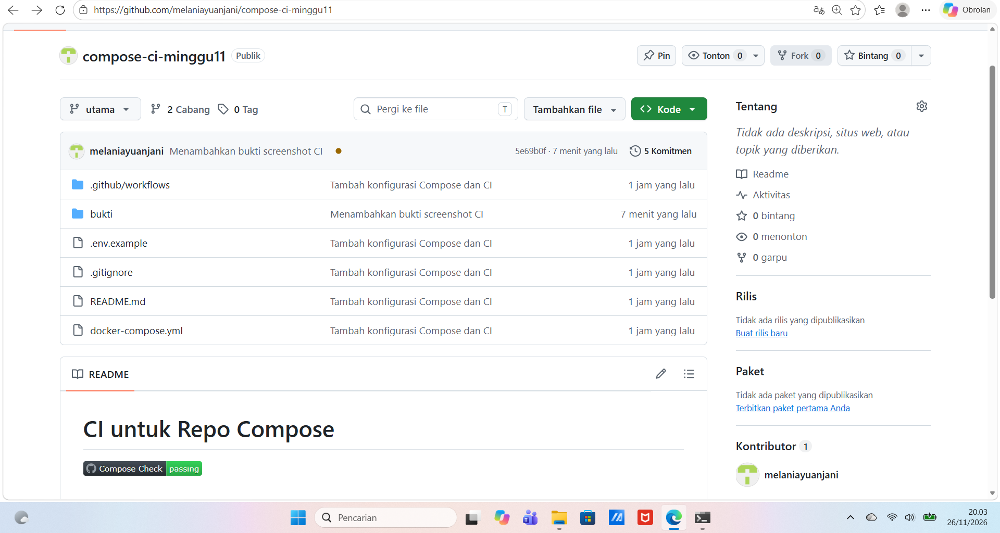
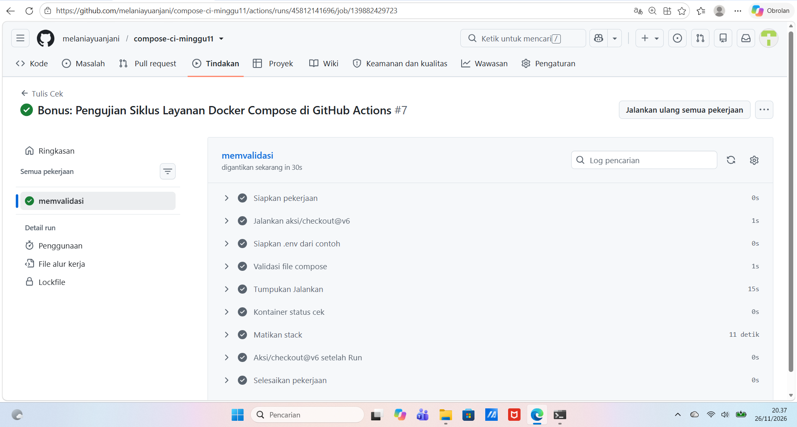

# Tugas Minggu 11: Continuous Integration pada Repository Compose

**Nama:** Melani Ayu Anjani  
**NIM:** 202557201010  
**Mata Kuliah:** Teknologi Open Source

## 1. Deskripsi

Repository ini merupakan proyek penerapan Continuous Integration (CI) menggunakan GitHub Actions pada konfigurasi Docker Compose.

Workflow dibuat agar pemeriksaan konfigurasi dapat berjalan secara otomatis ketika terdapat perubahan pada branch `main` maupun saat Pull Request dibuat.

Penerapan CI membantu mendeteksi kesalahan konfigurasi lebih awal sebelum perubahan diterapkan ke repository utama.

## 2. Struktur Repository

Berikut merupakan file dan folder yang digunakan dalam proyek ini:

- `.github/workflows/compose-check.yml` : File konfigurasi workflow GitHub Actions.
- `docker-compose.yml` : Konfigurasi layanan WordPress dan MariaDB.
- `.env.example` : Contoh variabel lingkungan aplikasi.
- `.gitignore` : Mengabaikan file tertentu seperti `.env`.
- `README.md` : Dokumentasi proyek.
- `bukti/` : Folder penyimpanan screenshot hasil pengerjaan.

## 3. Cara Kerja Workflow

GitHub Actions menjalankan pemeriksaan secara otomatis ketika ada push ke branch `main` atau ketika Pull Request dibuat.

Tahapan workflow meliputi:

1. Mengambil kode repository menggunakan `actions/checkout`.
2. Membuat file `.env` berdasarkan `.env.example`.
3. Memvalidasi konfigurasi menggunakan `docker compose config -q`.
4. Menjalankan layanan dengan `docker compose up -d`.
5. Memeriksa kondisi container menggunakan `docker compose ps`.
6. Menghentikan layanan dengan `docker compose down`.

## 4. Dokumentasi Bukti

### 4.1 Workflow Berhasil

Screenshot berikut menunjukkan GitHub Actions berhasil menjalankan proses validasi konfigurasi.

### 4.2 Pengujian Validasi Gagal

Pengujian dilakukan dengan membuat kesalahan pada konfigurasi Compose untuk memastikan workflow dapat mendeteksi kesalahan.

### 4.3 Badge Status CI

Badge digunakan untuk memperlihatkan status pemeriksaan workflow secara langsung pada halaman README repository.

### 4.4 Bonus Pengujian Docker Compose

Pengujian tambahan dilakukan dengan menjalankan layanan, memeriksa status container, dan menghentikan layanan melalui GitHub Actions.

Seluruh tahapan bonus berhasil dijalankan.

## 5. Kendala dan Penyelesaian

Selama pengerjaan proyek, terdapat beberapa kendala dalam proses validasi konfigurasi dan autentikasi GitHub.

Pengujian kegagalan dilakukan dengan mengubah konfigurasi Compose sehingga workflow menampilkan status gagal. Setelah kesalahan diperbaiki, pemeriksaan berhasil dijalankan kembali.

Selain itu, kendala autentikasi saat mengirim perubahan dari Ubuntu ke GitHub diselesaikan dengan membuat Personal Access Token baru.

## 6. Refleksi

Melalui tugas ini, saya memperoleh pemahaman mengenai penerapan Continuous Integration menggunakan GitHub Actions.

Saya juga mempelajari penggunaan Docker Compose, pengelolaan branch, commit, push, Pull Request, serta cara menguji konfigurasi dalam kondisi berhasil maupun gagal.

Penerapan CI membantu proses pengembangan menjadi lebih terstruktur karena kesalahan dapat diketahui lebih awal sebelum perubahan digabungkan ke branch utama.

